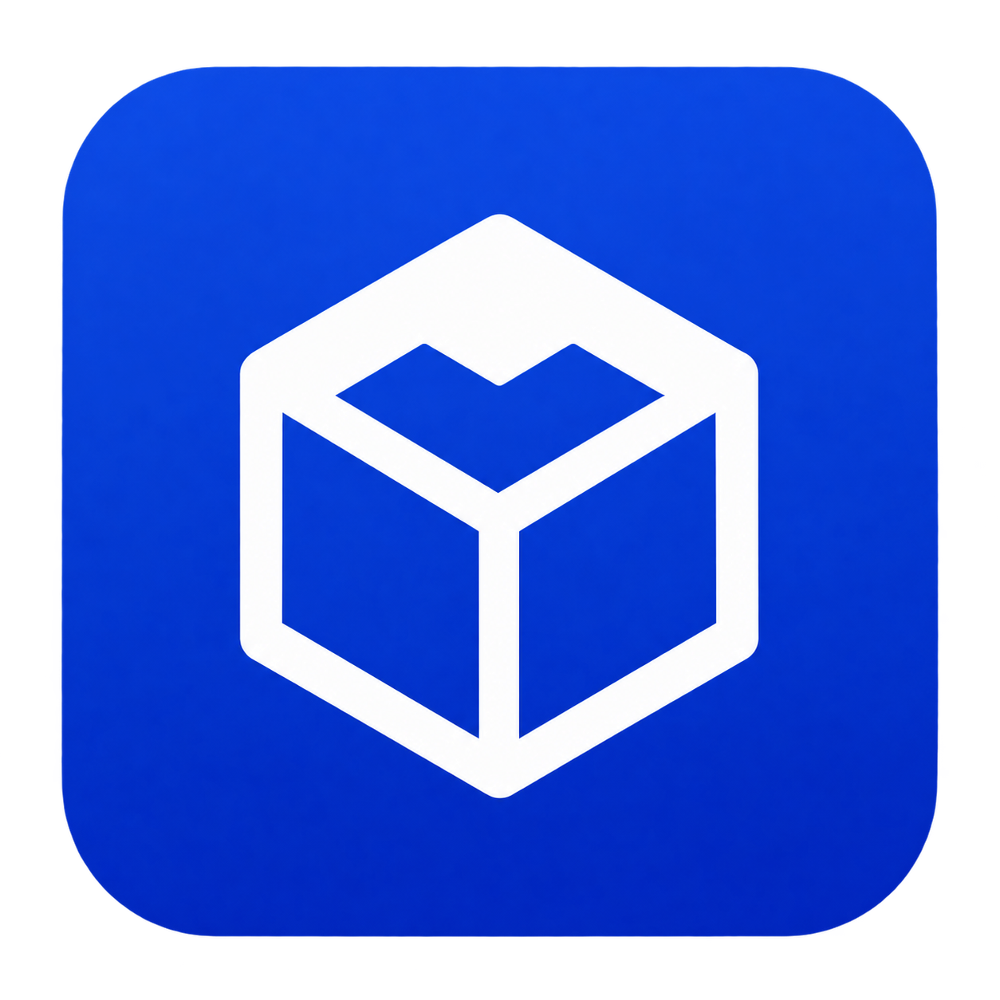

<div align="center">

# MultiHub
 
**Лаунчер и менеджер модов для Minecraft Java Edition на Windows**
 
Создавайте сборки, ставьте моды с проверкой зависимостей и управляйте установками других лаунчеров — в одном окне и на русском языке.
 


 

</div>
---
 
<a id="toc"></a>
 
## 📚 Содержание
 
- [✨ Возможности](#features)
- [📦 Установка](#install)
- [🚀 Быстрый старт](#quickstart)
- [🧩 Источники модов](#sources)
- [⚙️ Как работает установка модов](#how)
- [🖱️ Интеграция с Проводником](#explorer)
- [🔄 Автообновление](#updates)
- [💾 Где хранятся данные](#data)
- [🛠️ Сборка из исходников](#build)
- [🏷️ Выпуск релиза](#release)
- [❓ Частые проблемы](#faq)
- [📁 Структура проекта](#structure)
- [🗺️ Планы](#plans)
- [🩷 Участники проекта](#contributors)
- [⚖️ Лицензия](#license)
<a id="features"></a>
 
## ✨ Возможности
 
**Встроенный лаунчер**
- Установка и запуск Minecraft Java Edition (релизы от 1.16) — клиент, библиотеки, ресурсы и нужная версия Java скачиваются автоматически с серверов Mojang.
- Загрузчики: **Vanilla**, **Fabric** и **Forge**. Версию загрузчика можно выбрать вручную или оставить автоподбор.
- Каждая сборка — отдельная папка со своим ником и объёмом памяти (ползунок или готовые пресеты).
- Запуск в одиночной игре под локальным ником.
> [!NOTE]
> Авторизации Microsoft в лаунчере пока нет, поэтому серверы, которые проверяют сессию, недоступны.
 
 
**Менеджер модов**
- Каталог Modrinth, GitHub Releases, локальные JAR-файлы и CurseForge (при наличии API-ключа).
- Поддержка Fabric, Forge, NeoForge и Quilt.
- План установки: перед загрузкой видно, какие файлы будут скачаны, заменены или включены, и какие зависимости не удовлетворены.
- Раздел «Обновления»: новые версии модов с Modrinth для активной сборки; старые JAR сохраняются в `.modkit-updates`.
- Включение, отключение, удаление и импорт файлов модов; анализ метаданных JAR и сопоставление с Modrinth по SHA-512.
**Работа с чужими установками**
- Автопоиск и ручное подключение игровых папок других лаунчеров (для Prism Launcher — папка экземпляра с `mmc-pack.json` или её подпапка `.minecraft`).
- Несколько подключённых профилей, у каждого свои фильтры каталога.
- Подключённый профиль можно отключить — файлы игры останутся нетронутыми.
**Шейдеры, ресурспаки, миры**
- Шейдеры: подбор Iris для активной сборки, страница Oculus для поддерживаемых версий Forge, загрузка подходящего OptiFine с официального сайта, установка пакетов из Modrinth и импорт ZIP.
- Вкладки «Моды», «Шейдеры» и «Ресурспаки» в карточке сборки.
- Каталог ресурспаков, датапаков и миров с установкой в выбранную сборку.
**Интерфейс**
- Светлая и тёмная темы, у каждой своя обложка.
- Масштаб интерфейса от 75 % до 150 %, сетка или список, уведомления.
- Очередь загрузок с повторами, отменой и параллельными потоками.
<a id="install"></a>
 
## 📦 Установка
 
1. Откройте раздел [Releases](../../releases) и скачайте `MultiHub-Setup-<версия>-x64.exe`.
2. Запустите установщик. Галочка «Создать папку MultiHub» добавит подпапку к выбранному пути.
3. Требуется Windows 10 или 11 (x64).
> [!WARNING]
> Установщик не подписан сертификатом издателя, поэтому Windows SmartScreen может показать предупреждение. Скачивайте его только из [Releases](../../releases) этого репозитория. Целостность обновлений проверяется по SHA-512 из манифеста релиза.
 
<a id="quickstart"></a>
 
## 🚀 Быстрый старт
 
**Создать новую сборку**
 
1. Нажмите «Создать сборку» на главной или в «Моих сборках».
2. Укажите локальный ник, версию Minecraft и загрузчик.
3. Нажмите «Скачать и установить» и дождитесь окончания загрузки.
4. Запустите игру из «Моих сборок» или с главной страницы.
**Подключить существующую установку**
 
1. Нажмите «Подключить сборку» и выберите игровую папку из списка найденных или укажите её вручную.
2. Откройте каталог, выберите мод и проверьте план установки.
3. Управляйте установленными файлами на вкладке «Моды» в «Моих сборках».
<a id="sources"></a>
 
## 🧩 Источники модов
 
| Источник | Что нужно |
| --- | --- |
| **Modrinth** | Ничего, работает из коробки |
| **GitHub Releases** | Ничего. Для повышенного лимита запросов — токен в `MULTIHUB_GITHUB_TOKEN` |
| **Локальные файлы** | Добавьте свои JAR через системный диалог. Файлы копируются в хранилище MultiHub и доступны офлайн |
| **CurseForge** | Ключ API в переменной окружения `MULTIHUB_CURSEFORGE_API_KEY` |
 
- GitHub Releases работает с зарегистрированными репозиториями авторов (StereoCraft, Sodium, Lithium, Iris, Fabric API и др.). Показываются только совместимые JAR, опубликованные как файлы релиза.
- Ключ CurseForge передаётся только официальному API. Если автоматическая загрузка запрещена, MultiHub открывает страницу файла для ручного скачивания.
- Связи между площадками строятся по подтверждённым идентификаторам проектов — совпадение названий доказательством не считается.
- Для ручных загрузок MultiHub может следить за папкой «Загрузки» и предлагать импорт нужного JAR. Слежение включается вручную на вкладке загрузок и действует до перезапуска.
<a id="how"></a>
 
## ⚙️ Как работает установка модов
 
1. Вы выбираете мод и версию — MultiHub строит **план** для активной сборки.
2. Планировщик проверяет совместимость с версией игры и загрузчиком и рекурсивно разрешает обязательные зависимости (в том числе по метаданным самих JAR).
3. Для Forge 1.21.1 учитывается обратная совместимость с Minecraft 1.21.
4. Если есть блокирующие конфликты, установка не начинается. Иначе пакет файлов ставится целиком.
5. Каждая загрузка проверяется по контрольной сумме; в журнале сборки остаётся запись о действии.
<a id="explorer"></a>
 
## 🖱️ Интеграция с Проводником
 
Выделите один или несколько `.jar` в Проводнике и выберите **«Импортировать в MultiHub»**. MultiHub откроет единый план установки в выбранную сборку и подберёт обязательные зависимости.
 
- В Windows 11 команда появляется в верхнем контекстном меню, если установлен подписанный пакет `MultiHub.Explorer.msix`. Иначе она доступна в «Показать дополнительные параметры» как классическая команда.
- Интеграцию можно отключить в настройках, а при удалении MultiHub регистрация убирается.
<a id="updates"></a>
 
## 🔄 Автообновление
 
Установленная версия при запуске проверяет **стабильные публичные релизы** этого репозитория; проверку можно повторить в «Настройки → Обновление MultiHub». Скачивание и перезапуск запускаются кнопкой.
 
- Установщик проверяется по SHA-512 из `latest.yml`, загруженного по HTTPS.
- Черновики и пред-релизы обновление не запускают.
- Каталог данных, база SQLite, сборки и пользовательские файлы при обновлении сохраняются.
<a id="data"></a>
 
## 💾 Где хранятся данные
 
Всё лежит в `%APPDATA%\ModKit` (имя папки осталось от прежнего названия проекта):
 
| Путь | Содержимое |
| --- | --- |
| `modkit.sqlite` | Профили, настройки, история действий, кэш |
| `minecraft\` | Сборки MultiHub и общие файлы игры (`files\`) |
| `downloads\` | Временные загрузки |
| `local-content\` | Ваши локальные JAR |
 
Папка не удаляется при деинсталляции. Кэш можно очистить в настройках.
 
<a id="build"></a>
 
## 🛠️ Сборка из исходников
 
Нужны **Windows**, **Node.js 22+**. Для сборки обработчика Проводника — ещё инструменты C++ x64 из Visual Studio и Windows SDK.
 
```powershell
npm ci
npm run dev     # Vite + Electron с горячей перезагрузкой
npm run build   # проверка типов и production-сборка
npm start       # запуск собранной версии
npm run dist    # установщик NSIS + обработчик Проводника → папка release/
```
 
Чтобы пакет для верхнего меню Windows 11 был подписан, передайте отпечаток сертификата подписи кода из `Cert:\CurrentUser\My` в `MULTIHUB_EXPLORER_CERT_SHA1` и запустите `npm run dist`. Без сертификата собирается неподписанный MSIX (только для проверки манифеста), а в установщике остаётся классическое меню. Имя издателя должно быть одним и тем же во всех релизах.
 
<a id="release"></a>
 
## 🏷️ Выпуск релиза
 
1. Увеличьте `version` в `package.json` и закоммитьте в `main`.
2. Поставьте тег `vX.Y.Z` на этот коммит (должен совпадать с версией в `package.json`) и отправьте его.
3. GitHub Actions ([windows-release.yml](.github/workflows/windows-release.yml)) соберёт установщик, `.blockmap` и `latest.yml` и создаст **черновик** релиза.
4. Проверьте файлы и опубликуйте черновик — после этого пользователи получат обновление.
<a id="faq"></a>
 
## ❓ Частые проблемы
 
<details>
<summary><b>Windows пишет «Система Windows защитила ваш компьютер» при запуске установщика</b></summary>
Установщик собирается без сертификата издателя, поэтому SmartScreen показывает предупреждение. Нажмите «Подробнее» → «Выполнить в любом случае». Скачивайте установщик только из раздела [Releases](../../releases) этого репозитория.
</details>
<details>
<summary><b>Не могу зайти на сервер: «недействительная сессия» или «проверка имени»</b></summary>
MultiHub запускает игру под локальным ником, без авторизации Microsoft. Такие серверы пока недоступны, а в одиночной игре и на серверах без проверки сессии всё работает.
</details>
<details>
<summary><b>В каталоге нет CurseForge</b></summary>
Источник появляется только при заданном ключе API. Откройте PowerShell, выполните команду, затем полностью перезапустите MultiHub:
 
```powershell
setx MULTIHUB_CURSEFORGE_API_KEY "ваш_ключ"
```
</details>
<details>
<summary><b>Установка мода заблокирована в плане</b></summary>
Причина указана прямо в плане: мод несовместим с версией игры или загрузчиком, не найдена обязательная зависимость или она конфликтует с уже установленным файлом. Выберите другую версию мода или смените фильтры каталога.
</details>
<details>
<summary><b>Куда делась старая версия мода после обновления</b></summary>
Заменённые JAR лежат в папке `.modkit-updates` внутри игровой папки сборки — оттуда их можно вернуть вручную.
</details>
<details>
<summary><b>Команды «Импортировать в MultiHub» нет в меню Проводника</b></summary>
В Windows 11 без подписанного пакета команда спрятана в «Показать дополнительные параметры». Также проверьте, что интеграция включена в настройках MultiHub.
</details>
Не нашли свою проблему? Создайте [issue](../../issues).
 
<a id="structure"></a>
 
## 📁 Структура проекта
 
```
electron/   Главный процесс: IPC, SQLite, лаунчер, установщик, провайдеры каталогов,
            разбор JAR, шейдеры, OptiFine, автообновление
src/        Интерфейс на React, общие типы (shared.ts), правила совместимости
public/     Иконка, обложки тем, шрифт Golos Text (лицензия OFL)
build/      Ресурсы установщика: NSIS-скрипт, обработчик Проводника (C++), MSIX
scripts/    Скрипты dev-запуска и сборки
```
 
**Стек:** Electron, React 19, TypeScript, Vite, встроенный `node:sqlite`, `electron-updater`, `electron-builder` (NSIS).
 
<a id="plans"></a>
 
## 🗺️ Планы
 
- Полноценные резервные копии сборок
- Импорт и экспорт сборок
- Анализ игровых логов
<a id="covers"></a>
 
## 🎨 Обложки
 
`profile-cover-daylight.png` и `profile-cover-night.png` созданы с помощью ИИ-генерации изображений специально для проекта. Шрифт Golos Text распространяется по лицензии SIL OFL (см. `public/Golos-OFL.txt`).
 
<a id="contributors"></a>
 
## 🩷 Участники проекта
 
[](https://github.com/blksmamba/MultiHub/graphs/contributors)
 
<a id="license"></a>
 
## ⚖️ Лицензия
 
Copyright © 2026 blksmamba, MultiHub
 
Проект распространяется по лицензии [GNU General Public License v3.0](LICENSE). Вы можете свободно использовать, изменять и распространять код, но производные версии тоже должны оставаться открытыми под GPL-3.0. Программа поставляется «как есть», без каких-либо гарантий.
 
Minecraft принадлежит Mojang AB / Microsoft. MultiHub — неофициальный проект и не связан с Mojang, Microsoft, Modrinth или CurseForge.
 
